<div align="center">
  
</div>

<p align="center">
  <a href="#architecture-topology"></a>
  <a href="#architecture-topology"></a>
  <a href="#architecture-topology"></a>
  <a href="#mobile--accessibility-engineering"></a>
  <a href="#tier-3-webgl2-physical-simulation-engine"></a>
  <a href="#production-deployment--live-endpoints"></a>
</p>
<p align="center">
  <a href="#mobile--accessibility-engineering"></a>
  <a href="#architecture-topology"></a>
  <a href="https://thekittycorp.com/"></a>
  <a href="#verification--quality-assurance-suite"></a>
  <a href="#verification--quality-assurance-suite"></a>
  <a href="#license"></a>
</p>

---

## Executive Overview

**Kitty Corp** is a frontier technology company engineering high-fidelity digital simulation systems, applied intelligence platforms, and high-performance web software. The flagship web platform combines real-time WebGL2 GPU shader simulations with enterprise-grade Next.js server-driven architectures to deliver an ultra-responsive, accessible, and visually striking presentation of corporate divisions, released software, and research initiatives.

See **OWNER-GUIDE.md** for complete owner operations. The `handover/` directory contains configuration templates, structural source maps, Technical Architecture & Maintainer Handover Guide, disaster recovery protocols, public content snapshots, and cryptographic checksum manifests.

---

## Architecture Topology

The platform is engineered across a 5-tier modular topology ensuring rigorous isolation between interface rendering, edge compute, GPU acceleration, security boundaries, and persistence.

```
+-----------------------------------------------------------------------------------+
|                   TIER 1: CLIENT EXPERIENCE & PRESENTATION LAYER                  |
|  React 19 Server/Client Components | Dark Glassmorphism | WCAG 2.1 AAA Tokens     |
|  Geist Sans & Mono | Self-Hosted Dirtyline 36D Commercial Display Typography      |
+---------------------------------------------------------+-------------------------+
                                                          |
+---------------------------------------------------------v-------------------------+
|                    TIER 2: NEXT.JS 16.4.4 TURBOPACK EDGE RUNTIME                  |
|  App Router | Hybrid SSR & Static Edge Prerendering | BOM1 Edge Node Distribution |
|  Dynamic Route Handlers | Server Action Boundaries | Real-Time Cache Revalidation  |
+----------------------------+----------------------------+-------------------------+
                             |                            |
       +---------------------+                            +-------------------+
       v                                                                      v
+---------------------------------------+  +----------------------------------------+
| TIER 3: WEBGL2 SIMULATION ENGINE      |  | TIER 4: SECURITY & COMMERCE GATEWAY    |
| 13 Hardware-Accelerated GLSL Shaders  |  | Cloudflare Turnstile Challenge Mesh    |
| Interactive Lightning Contour Field   |  | Google OAuth 2.0 PKCE Studio Gateway   |
| 30 FPS Throttling & 1.15 Mobile Clamp |  | Razorpay Payment Gateway & HMAC Verify |
| Non-Blocking Touch Pass-Through Mesh  |  | Encrypted Runtime Secret Storage       |
+---------------------------------------+  +-------------------+--------------------+
                                                               |
+--------------------------------------------------------------v--------------------+
|                   TIER 5: PERSISTENCE, AUDIT & STORAGE LAYER                      |
|  Supabase PostgreSQL Relational Core | Granular Row-Level Security (RLS) Policies |
|  SHA-256 APK Binary Validation Store | Structured Contact & Enquiries Ledger      |
+-----------------------------------------------------------------------------------+
```

### Detailed Tier Breakdown

1. **Tier 1 — Client Experience & Presentation Layer**:
   - Modern React 19 architecture with strict separation of server rendering and interactive client boundaries.
   - Design system orchestrated via CSS custom properties: `system-theme.css`, `gemini-home.css`, `ui-refresh.css`, and `professional.css`.
   - Comprehensive dark glassmorphism (`rgba(20, 24, 42, 0.90)` with `backdrop-filter: blur(12px)`) providing superior visual hierarchy across all viewports.
   - Complete typography scale pairing Geist for high-legibility body interfaces and self-hosted Dirtyline 36D for executive display headings.

2. **Tier 2 — Next.js Turbopack Edge Runtime**:
   - Next.js 16.4.4 compiled with Turbopack for rapid compilation and optimized bundle slicing.
   - Hosted on Vercel's global edge network, optimized for the `bom1` (Mumbai) low-latency region.
   - Strict static prerendering for marketing routes with incremental dynamic data revalidation for editorial journals and software releases.

3. **Tier 3 — WebGL2 Physical Simulation Engine**:
   - 13 distinct WebGL2 and Three.js GLSL shaders (`src/shaders/` and `components/`) delivering physical lightning contour simulations.
   - Hardware-accelerated canvas with automatic DPR clamping (1.15 on mobile viewports) and adaptive 30 FPS throttling to eliminate battery and thermal strain.
   - Non-blocking pointer event pass-through ensuring flawless scrolling and touch interactions.

4. **Tier 4 — Security, Commerce & Gateway Middleware**:
   - Cloudflare Turnstile automated challenge integration guarding public forms, enquiry brief dispatches, and edge assistants.
   - Studio management console protected exclusively by Google OAuth 2.0 PKCE authentication tied to the verified administrator UUID.
   - Razorpay payment and donation pipeline with strict cryptographic HMAC SHA-256 signature verification.
   - Zero-secret exposure: sensitive credentials stored in AES-encrypted runtime configurations decrypted server-side via private tokens.

5. **Tier 5 — Persistence, State & Storage Layer**:
   - Supabase PostgreSQL database governed by declarative Row-Level Security (RLS) policies.
   - Isolated asset buckets: public WebP media delivery alongside private draft storage.
   - Ingest verification validating APK binary sizes, ZIP headers, and SHA-256 integrity hashes prior to public catalog publication.

---

## Core Divisions & Active Route Matrix

| Route | Division / Purpose | Rendering Mode | Security & Compliance |
|:------|:-------------------|:---------------|:----------------------|
| `/` | **Corporate Homepage** — Digital Solutions, Intelligence & Robotics, work showcase, executive brief | Static Prerendered | Public / CSRF-Protected Briefs |
| `/services` | **Enterprise Solutions** — Architecture consulting, custom software development, confidential briefs | Static Prerendered | Rate-Limited Origin Verification |
| `/products` | **Software Directory** — Deployed applications, verified Android APK packages, live deployments | Static Prerendered | Public Catalog |
| `/research` | **Applied Research** — Computational simulations, robotics telemetry, algorithmic architectures | Static Prerendered | Public Editorial |
| `/company` | **Corporate Entity** — Organizational trajectory, operating philosophy, cinematic brand presentation | Static Prerendered | Public Editorial |
| `/team` | **Engineering Leadership** — Technical biographies, executive roster, authenticated public credentials | Static Prerendered | Studio RLS Managed |
| `/contact` | **Communications Gateway** — Institutional inquiries, executive press contact, secure messaging | Static Prerendered | Cloudflare Turnstile Protected |
| `/appointments` | **Consultation Appointments** — Direct strategy booking, calendar scheduling, inquiry brief | Static Prerendered | Cloudflare Turnstile Protected |
| `/support` | **Voluntary Support** — Hardware prototyping contributions, robotics research funding | Static Prerendered | Razorpay Verified Gateway |
| `/account` | **Customer Portal** — Account management, verified identities, authenticated session state | Dynamic Server-Side | HttpOnly Session Authentication |
| `/memberships` | **Partner Memberships** — Tiered institutional memberships, access controls, feature entitlements | Dynamic Server-Side | Authenticated RLS Policies |
| `/payments` | **Financial Clearing** — Project payment processing, retainer settlements, voluntary support | Dynamic Server-Side | Razorpay Test & Production Gateway |
| `/projects` | **Project Directory** — Commissioned client initiatives, engagement tracking, milestones | Static Prerendered | Public Portfolio |
| `/play` | **Interactive Playground** — Computational graphics demos, algorithmic Snake engine, simulation trials | Static Prerendered | Client-Side WebGL / Canvas |
| `/kitten` | **Executive Studio** — Content management, journal authoring, APK release approval, inbox management | Dynamic Server-Side | Google PKCE Authenticated Owner Only |
| `/secretchat` | **Private Communications App** — Verified APK release 1.5.0, integrity guidelines, cryptography notes | Static Prerendered | Cryptographic SHA-256 Verified |
| `/build-log` | **Engineering Journal** — Technical dispatches, architecture post-mortems, category-filtered articles | Static Prerendered | Public Editorial |

---

## Mobile & Accessibility Engineering

The entire platform is engineered according to the **WCAG 2.1 AAA** standard and audited across all viewport dimensions:

- **Viewport Fluidity (320px to 4K)**:
  - Custom responsive breakpoints: `@media (max-width: 420px)`, `@media (max-width: 760px)`, `@media (max-width: 1024px)`.
  - Zero horizontal overflow (`overflow-x: clip` and `max-w-full` constraints applied across all card containers and layout grids).
  - Adaptive table wrappers preventing horizontal scroll clipping on compact mobile devices.

- **Touch Target Integrity (>= 44px)**:
  - All interactive elements — including header navigation pills, theme toggles, mobile menu triggers, form inputs, and footer links — enforce minimum dimensions of `44px x 44px` per WCAG Target Size Success Criterion 2.5.5.
  - Comfortable finger padding and clear visual tap feedback states on touch interfaces.

- **Contrast & Visual Ergonomics**:
  - Deep obsidian foundations (`#060813` to `#0d1424`) paired with high-contrast text tokens (`#f8fafc`, `#c4c9db`, `#69dcf2`) ensuring contrast ratios exceeding `10:1` (surpassing the WCAG AAA 7:1 threshold).
  - Eliminates low-contrast muted tones in dark mode while preserving native system appearance synchronization when light mode is explicitly toggled.

- **Reduced Motion Compliance**:
  - Strict `@media (prefers-reduced-motion: reduce)` media queries disable WebGL lightning animation loops, halt marquee scrolls, and replace dynamic canvas backgrounds with refined static obsidian gradients.

---

## Local Development & Setup

### Prerequisites

- **Node.js**: Version 24.x LTS recommended (minimum 20.x).
- **Package Manager**: `npm` using the committed lockfile (`package-lock.json`).

### Quick Start

```bash
# 1. Install locked dependencies
npm ci

# 2. Configure environment parameters
cp .env.example .env.local
# Edit .env.local with your private sandbox credentials

# 3. Launch development server with Turbopack
npm run dev:next

# 4. Access local environment
# Open http://localhost:3000 in your browser
```

---

## Studio Management Console (`/kitten`)

The platform includes a dedicated, private administrative console accessible at `/kitten` (formerly `/admins`, now retired).

1. **Authentication Architecture**:
   - Access is restricted exclusively to the approved administrator account through a Google OAuth 2.0 PKCE flow.
   - Password-based logins and public Studio hyperlinks are intentionally omitted from the codebase.
   - Sessions are secured with `HttpOnly`, `Secure`, `SameSite=Lax` cookies, supplemented with same-origin header verification on mutating actions.

2. **Publishing Modules**:
   - **Build Log & Updates**: Draft, schedule, and publish technical articles and updates. Supports markdown syntax, image descriptions, and automatic UTC scheduling.
   - **Apps & Website Releases**: Manage signed Android APK binaries (up to 50 MB with direct upload via signed URLs) and website launch profiles. Real-time validation checks file sizes, SHA-256 checksums, and APK ZIP structures.
   - **Early Access Roster**: Inspect incoming partner and beta signups with private export capabilities.
   - **Client Enquiries & Inbox**: Secure repository for inbound client briefs, consultation requests, and customer feedback.
   - **Reviews & Testimonials**: Author and curate authenticated client reviews with attribution and source links.
   - **Site Controls & Maintenance**: Toggle platform-wide maintenance mode with revision collision guards and emergency override mechanisms.

---

## Verification & Quality Assurance Suite

Every release undergoes rigorous automated verification across TypeScript static analysis, ESLint standards, commerce testing, security integration tests, and Turbopack production compilation.

Run the full verification suite locally:

```bash
# Execute comprehensive 15-suite website verification (cache, security, commerce, accounts)
npm run check:website

# Execute strict static analysis and linting
npm run lint

# Execute native Turbopack production compilation
npm run build:next
```

### Verification Suite Coverage (15 Sub-Suites)

| # | Sub-Suite Test | Validated Capabilities |
|---|:---------------|:-----------------------|
| 1 | `tsc` Static Analysis | 100% strict TypeScript typing across all components, API routes, and utilities |
| 2 | `test-performance.mjs` | Cache-Control headers, public asset revalidation, stale-while-revalidate limits |
| 3 | `test-studio-security.mjs` | Google-only PKCE verification, admin UUID authorization, origin validation |
| 4 | `test-analytics.mjs` | First-party telemetry collection, non-PII compliance, event throttling |
| 5 | `check-website-assistant.mjs` | Edge assistant gateway proxies, Turnstile validation, fallback handlers |
| 6 | `test-razorpay.mjs` | Payment order creation, webhook cryptographic HMAC SHA-256 verification |
| 7 | `test-commerce.mjs` | Product catalog schema, digital delivery links, inventory state handling |
| 8 | `test-project-quotes.mjs` | Project milestone fee calculators, discount formulas, installment schedules |
| 9 | `test-business-conversion.mjs` | Brief submission sanitize filters, rate-limiting locks, honeypot traps |
| 10 | `test-discount-game.mjs` | Algorithmic Snake game score validation, anti-cheat signature tokens |
| 11 | `test-customer-accounts.mjs` | Verified identity state, session persistence, secure cookie attributes |
| 12 | `test-lisa-preorders.mjs` | Hardware preorder allocation limits, idempotent state transitions |
| 13 | `test-memberships.mjs` | Membership entitlement verification, role checks, access restrictions |
| 14 | `test-email-notifications.mjs` | Transactional email alert queues, retry logic, SMTP/API failover |
| 15 | `verify-hosting.mjs` | Vercel production hosting configuration, `bom1` Mumbai region lock, route integrity |

---

## Production Deployment & Live Endpoints

- **Live Production URL**: [https://thekittycorp.com/](https://thekittycorp.com/)
- **Hosting Provider**: Vercel Enterprise Platform (`bom1` Mumbai edge region)
- **Continuous Integration**: `.github/workflows/verify.yml` automatically triggers on push to `main` branch.
- **Git Push Refspec**: `git push origin master:main` updates production deployment.

### Live Production Crawler Verification

Post-deployment integrity is audited using automated crawler inspection:
- HTTP 200 status code verification across all 65 static and dynamic routes.
- Real-time DOM validation confirming WebGL canvas instantiation and responsive navigation rendering.
- Zero broken static links, missing assets, or unhandled exceptions.

---

## License & Ownership

Copyright © 2026 Kitty Corp. All rights reserved.

Proprietary software and brand assets. Unauthorized reproduction, distribution, reverse engineering, or public mirroring of proprietary source code and shader algorithms is strictly prohibited.
